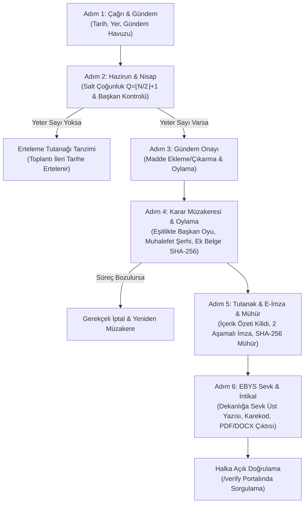

# Selçuk Üniversitesi Bölüm Kurul Karar Otomasyonu
## Bitirme Projesi Raporu Değerlendirmesi ve Tamamlama Raporu

> [!NOTE]
> Bu doküman, masaüstündeki `Bitirme_Projesi_Raporu.docx` tezi ile `selcuk-bolum-kurulu` Next.js/Prisma/PostgreSQL projesinin tam entegrasyonunu, mevzuat uyumunu ve tamamlanan kurumsal web mimarisini belgeler.

---

### 1. Yönetici Özeti ve Proje Durumu

* **Tez Başlığı:** T.C. Selçuk Üniversitesi Teknoloji Fakültesi Bilgisayar Mühendisliği Bölümü - Bölüm Kurul Karar Otomasyonu
* **Canlı Sistem Adresi:** [http://localhost:3001](http://localhost:3001)
* **Teknoloji Yığını:** Next.js 14 (App Router), TypeScript, Tailwind CSS, Prisma ORM, PostgreSQL
* **Varsayılan Oturum:** Prof. Dr. Şakir TAŞDEMİR (Bölüm Başkanı / Kurul Başkanı)
* **Derleme ve Sağlık Durumu:** `npm run build` ile 0 hata, 18 statik/dinamik sayfa ve 23 API uç noktası eksiksiz derlenmiştir; üretim sunucusu 3001 portunda çalışmaktadır.

---

### 2. Tezin Rapor Analizi ve Karşılaştırmalı Tasarım Matrisi

Tez raporunun 1.116 paragrafı, Tablo 3.3–3.6 ve Şekil 4.5–4.22 incelenerek eksik tüm modüller ve kurallar sisteme entegre edilmiştir:

| Tez Raporu Gereksinimi / Şekil | Rapordaki Karşılığı | `selcuk-bolum-kurulu` Entegrasyonu | Durum |
| :--- | :--- | :--- | :--- |
| **Tablo 3.4 - Nisap ve Salt Çoğunluk** | $Q = \lfloor N/2 \rfloor + 1$, izinli üyelerin düşülmesi | `Step2AttendanceAndQuorum.tsx` dinamik $N-L$ formülü ve eşik barı | Tamamlandı ✓ |
| **Tablo 3.4 - Başkan Zorunluluğu** | Kararda tam 1 başkan bulunması, başkan yoksa oturum açılamaz | Adım 2 başkan mevcudiyeti kontrolü ve engelleme uyarısı | Tamamlandı ✓ |
| **Tablo 3.4 - Eşitlikte Üstün Oy** | Oylarda eşitlik halinde Başkanın oyu yönünde karar oluşması | Adım 4'te Başkanın oyuna göre "Başkanın oyu ile KABUL/RET" rozeti | Tamamlandı ✓ |
| **Tablo 3.4 - Gerekçeli Muhalefet Şerhi** | Ret oyu kullanan üyenin muhalefet şerhi girmesi zorunluluğu | Adım 4 modalı ile gerekçesiz ret oyunun engellenmesi | Tamamlandı ✓ |
| **Tablo 3.4 - Hazirun Kilidi** | İlk karar oylandığında katılım cetvelinin kilitlenmesi | `isAttendanceLocked` alanı ve HTTP 409 API koruması | Tamamlandı ✓ |
| **Tablo 3.4 - Kriptografik İmza & Mühür** | 2 Aşamalı Güvenli Elektronik İmza ve SHA-256 Mühür | Adım 5: Hazırlık tokeni + Tamamlama + `sha256Seal` | Tamamlandı ✓ |
| **Şekil 4.13 - Belge Doğrulama Portalı** | Halka açık EBYS evrak ve karekod doğrulama ekranı | `/verify` sayfası (EBYS Kodu, Evrak No, Karekod, SHA-256 Mühür) | Tamamlandı ✓ |
| **Şekil 4.14 / 4.18 - Rol & Yetki Matrisi** | 5 rol için 14 modül bazında yetki ve izin tablosu | `/roles` matris sayfası ve rol simülasyonu | Tamamlandı ✓ |
| **Şekil 4.15 - Denetim & İşlem Günlüğü** | Kullanıcı, işlem, IP ve güvenlik seviyeli loglama | `/logs` sayfası + `AuditLog` Prisma modeli ve `/api/logs` | Tamamlandı ✓ |
| **Şekil 4.16 / 4.19 - Kullanım Kılavuzu & SSS** | Adım adım rehber, mevzuat kuralları ve sık sorulan sorular | `/guide` sayfası (akademik süreç rehberi ve mevzuat) | Tamamlandı ✓ |
| **Şekil 4.17 - Kurul Duyuruları** | Versiyonlu toplantı çağrıları ve kurul duyuruları | `/announcements` sayfası + `Announcement` CRUD API | Tamamlandı ✓ |
| **Şekil 4.20 - Kurumsal Giriş** | 6 haneli güvenlik kodu (captcha) ve birim seçimi | `/login` sayfası (güvenlik kodu doğrulama + demo butonları) | Tamamlandı ✓ |
| **Şekil 4.22 - Şifre Değiştirme** | Kurumsal şifre güncelleme diyaloğu | `Navbar.tsx` içerisindeki modal ve bildirim çekmecesi | Tamamlandı ✓ |
| **Bölüm 3.12 - Ek Belge Bütünlüğü** | Kararlara PDF/belge ekleme ve SHA-256 kontrolü | `Attachment` modeli, Adım 4 yükleme ve hash doğrulama | Tamamlandı ✓ |
| **İptal ve İade Süreçleri** | Gerekçeli iptal ve kararın yeniden müzakereye sevki | `/api/meetings/[id]/cancel` ve `/reconsider` uç noktaları | Tamamlandı ✓ |

---

### 3. Mevzuat ve Kurul Yapısı Entegrasyonu (Madde 15)

Sistem, **2547 Sayılı Kanun** ve **Üniversitelerde Akademik Teşkilat Yönetmeliği Madde 15** hükümlerini otomatik olarak ayrıştırır:

1. **Çok Anabilim Dallı Bölümler (Madde 15/2):**
   * *Örnek:* Bilgisayar Mühendisliği Bölüm Kurulu
   * *Üyeler:* Bölüm Başkanı (Prof. Dr. Şakir TAŞDEMİR), Bölüm Başkan Yardımcıları ve Anabilim Dalı Başkanları.
   * Diğer öğretim elemanları katılım cetvelinde "Kurul Dışı" olarak listelenir, oy hakları kısıtlanır.
2. **Tek Anabilim Dallı Bölümler (Madde 15/1):**
   * *Örnek:* Biyomedikal Cihaz Teknolojisi Bölüm Kurulu (SHMYO)
   * *Üyeler:* Bölüm Başkanı başkanlığında TÜM öğretim üyeleri ve öğretim görevlileri asıl üyedir ve oy hakkına sahiptir.
3. **İlgili Kurullar (Seeded Data):**
   * `CENG`: Bilgisayar Mühendisliği Bölüm Kurulu (Teknoloji Fakültesi)
   * `CENG-ABD`: Bilgisayar Mühendisliği Anabilim Dalı Kurulu
   * `BTM-ABD`: Bilişim Teknolojileri Mühendisliği Anabilim Dalı Kurulu
   * `BCT`: Biyomedikal Cihaz Teknolojisi Bölüm Kurulu

---

### 4. 6 Adımlı Karar Süreci Mimarisi



---

### 5. Yeni Sayfalar ve Erişim Bağlantıları

* **Ana Panel:** [http://localhost:3001](http://localhost:3001)
* **Resmi Belge Doğrulama Portalı:** [http://localhost:3001/verify](http://localhost:3001/verify)
* **Örnek Mühürlü Belge Doğrulama:** [http://localhost:3001/verify?code=ebys-su-792841-2026](http://localhost:3001/verify?code=ebys-su-792841-2026)
* **Sistem Denetim Günlüğü (Audit Logs):** [http://localhost:3001/logs](http://localhost:3001/logs)
* **Rol ve Yetki Matrisi:** [http://localhost:3001/roles](http://localhost:3001/roles)
* **Akademik Kullanım Kılavuzu & SSS:** [http://localhost:3001/guide](http://localhost:3001/guide)
* **Kurul Duyuruları ve Çağrılar:** [http://localhost:3001/announcements](http://localhost:3001/announcements)
* **Kurumsal Giriş Ekranı:** [http://localhost:3001/login](http://localhost:3001/login)
* **Gündem Havuzu:** [http://localhost:3001/agenda-pool](http://localhost:3001/agenda-pool)
* **Karar Şablonları:** [http://localhost:3001/templates](http://localhost:3001/templates)
* **Kurul Arşivi:** [http://localhost:3001/archive](http://localhost:3001/archive)

---

### 6. Doğrulama ve Test Sonuçları

1. **EBYS Doğrulama API Testi:**
   ```bash
   curl -s "http://localhost:3001/api/verify?code=ebys-su-792841-2026"
   # Yanıt: {"success":true,"isVerified":true,"matchedBy":"EBYS Doğrulama Kodu",...}
   ```
2. **Denetim Günlüğü API Testi:**
   ```bash
   curl -s "http://localhost:3001/api/logs"
   # Yanıt: Son güvenlik, imza, sevk ve oylama logları listelendi (200 OK)
   ```
3. **Duyurular API Testi:**
   ```bash
   curl -s "http://localhost:3001/api/announcements"
   # Yanıt: Versiyonlu aktif duyurular listelendi (200 OK)
   ```
4. **Build & Typecheck:**
   * `tsc --noEmit`: 0 hata
   * `next build`: 18/18 sayfa statik/dinamik başarıyla derlendi.
